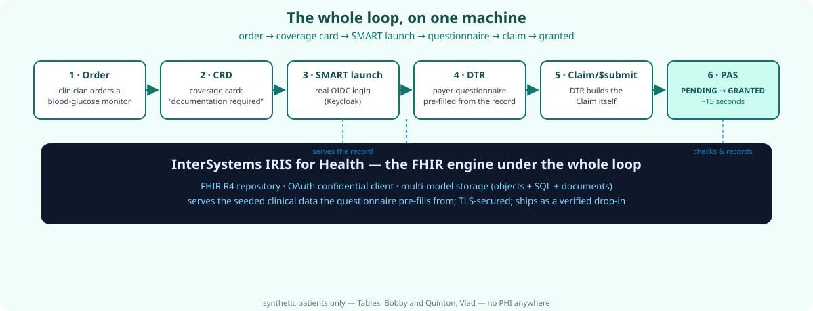

# I ran the real DaVinci prior-auth loop (CRD → DTR → PAS) and shipped it as a one-command lab

**No cloud. No PHI. No license request. A real browser walks an order to a
`GRANTED` claim in half an hour — with InterSystems IRIS for Health doing the
FHIR work underneath.**



---

## The short version

Prior authorization — the gate between a prescription and a patient getting
it — is still 88% manual, at a system cost of an estimated **$23–31B a year**.
The standards that fix it (HL7 DaVinci's CRD/DTR/PAS) have been published for
years. What's been missing is the **whole loop, running, somewhere you can
watch it fire**.

So I built the smallest machine that contains it, against the real product:

- **CRD** returns a coverage card at order time ("Documentation Required").
- Clicking the card does a **real SMART/OIDC launch** through a real login
  page.
- **DTR** renders the payer's questionnaire with live value-set options and
  pre-fills it from the record — then builds the `Claim` itself. (The
  load-bearing detail: the SMART app submits the claim, not the EHR.)
- **PAS** answers `Claim/$submit` and the browser shows
  **`PENDING` → `GRANTED`**.

Two independent drivers verify it: **12/12 API assertions + 14/14
real-browser assertions**. Both green.

## Why IRIS for Health

The easy move is a stub FHIR server. I did the opposite: **InterSystems IRIS
for Health** — a real production clinical-data platform with a native FHIR R4
repository — provisioned, seeded with synthetic patients, and proven with
receipts:

- FHIR R4 CapabilityStatement over **TLS** (cold boot to 200 in seconds)
- **OAuth confidential client**, token-minting shim per upstream call
- ships as a **checksum-verified LXC drop-in image**, auto-start, clean
  shutdowns

For InterSystems: this is a third-party, public, reproducible proof of your
product as a FHIR engine — one command to try, MIT-licensed, documented for
humans *and* AI agents. Community Edition, no account, no license request.

For hospitals: the FHIR-based payer-interoperability future, decompressed
into one afternoon — order-time coverage, SMART launch, questionnaires,
value sets, and a claim reaching a payer as structured data.

## Run it

```bash
git clone https://github.com/Abaabeel/iris-fhir.git
cd iris-fhir
sudo bash bin/lxc-import.sh github   # the self-contained image, checksum-verified
# the container starts IRIS + all six services itself — nothing runs on your host
lxc-attach -n iris-fhir -- bash -c 'cd /opt/davinci-mock && bash bin/demo.sh'  # 12/12
ADVERTISE_HOST=10.0.3.108 python3 bin/e2e-browser.py                          # 14/14, real browser
# open http://10.0.3.108:3001/ and click through to a GRANTED claim
```

Full write-up: [The smallest machine that contains the whole future of prior
authorization](blog-post.md). README: <https://github.com/Abaabeel/iris-fhir>.

The FHIR future is not coming. It runs on one machine, and you can watch it
grant a claim in half an hour.